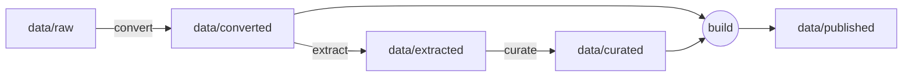

# Architecture

How GraphEA's pieces fit together. For why each choice was made, see
[decisions](decisions/).

## Data flow

| Layer | Holds | Written by | Rebuildable |
|---|---|---|---|
| `raw/` | Sources + manifests, add-only | Curator | No |
| `converted/` | Markdown from sources | Conversion pipelines | Yes |
| `extracted/` | Proposed entities, edges and matches, one file per run | Extraction (unattended or in a session) | Re-runnable; runs are kept |
| `curated/` | Accepted nodes, edges and narrative | Directed sessions only | No |
| `published/` | Combined output for consumers | The build | Yes |

`data/inbox/` is a local scratch area for downloads before they are
imported into `data/raw/`. It is outside the lifecycle layers and never
committed.

## Records

Nodes and edges are JSON files named by ID, one record per file, in
`nodes/` and `edges/` folders.

| Field | Nodes | Edges | Notes |
|---|---|---|---|
| `id` | ✓ | ✓ | Read-only. Nodes: `type.name`; edges: `from--type--to` |
| `type` | ✓ | ✓ | Read-only. On nodes, matches the ID prefix |
| `from`, `to` | | ✓ | Read-only |
| `name`, `aliases` | ✓ | | Display name may change; aliases drive matching |
| `origin` | ✓ | ✓ | `documented`, `observed`, `asserted`, `synthetic` |
| `verification` | ✓ | ✓ | `unverified`, `verified` |
| `states` | ✓ | ✓ | `current` (known to exist now), `target`, `past` |
| `basis` | | ✓ | `stated`, `inferred` |
| `verifiedHash` | ✓ | ✓ | Hash of the content when verified ([0024](decisions/0024-verification-bound-to-content.md)) |
| `provenance` | ✓ | ✓ | Evidence (with locators and conversion hashes), claims, curator and session, timestamps ([0023](decisions/0023-evidence-claims-and-provenance.md)) |
| `tags` | optional | optional | Lowercase kebab-case |
| `distinctFrom` | ✓ | | Rejected matches |

Every record validates against the schema for its type in `schemas/`;
unknown fields are rejected ([0016](decisions/0016-schema-conventions.md)).
Extraction output uses the parallel proposal schemas in
`schemas/proposals/`, which have no IDs or trust fields
([0020](decisions/0020-proposal-and-record-schemas.md)).

Merged records become tombstones (`mergedInto`), which keep their IDs
reserved. Narrative markdown is linked to records by ID.

## Matching

Extracted entities are matched to curated records in tiers: an existing
ID whose name agrees, exact alias, candidate match for review, or
proposed new entity. Pipelines never create IDs.

## Change detection

- **Extraction runs** are keyed on input hash, prompt hash, model and
  schema version; unchanged keys are skipped.
- **Staleness:** when a raw source is superseded, or a newer conversion
  of it differs from the one cited, records citing it are published with
  a stale flag and listed in a report.
- **Outdated verification:** when a verified record's content no longer
  matches its `verifiedHash`, it is published as unverified with
  `verificationOutdated` and listed in a report.
